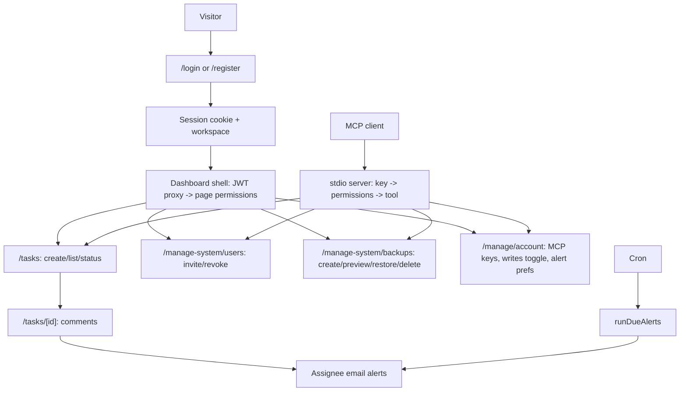
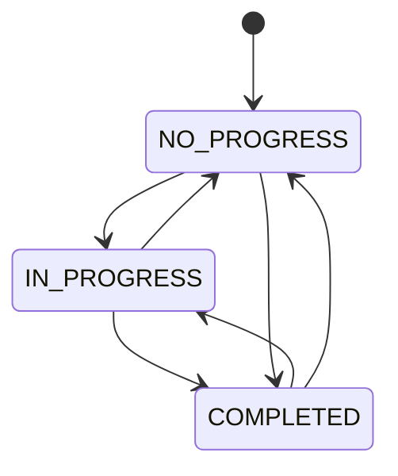

# Consologist TMS — Requirements-to-Outcome Architecture and Domain Flow

Last checked: 2026-11-19. Status: static implementation reconciliation; **no runtime database execution**. Read `docs/domain/INDEX.md` first.

## Objective, Scope, and Outcomes

Consologist TMS is a multi-tenant task-management application. It must preserve one business truth — **a workspace owns groups → projects → lists → tasks, and tasks carry status, multiple assignees, tags and comments** — and turn it into useful outcomes: people see their work, assignments are clear, due work is alerted, comments are visible, and a workspace can be backed up and restored.

Actors: workspace member (all roles), admin, MCP agent acting as a member, cron job. Beneficiaries: workspace members and the MCP client operator.

| Requirement ID | Entry / prerequisites | Ordered actions, branches, handoffs | Responsible elements | Benefit / terminal outcome | Acceptance test / status |
|---|---|---|---|---|---|
| REQ-01 | Visitor at `/register` | register → user + company + SUPER_ADMIN role + starter group/project/list/apps → session cookie → `/dashboard` | ACT-REG, ENT-USER, ENT-COMPANY, UT-SEED | Workspace exists and owner is signed in | No DB run; statically traced |
| REQ-02 | Visitor at `/login` | email/password → bcrypt compare → DB session + JWT cookie → `returnTo || /dashboard` | ACT-LOGIN, ENT-SESSION, PAGE-LOGIN | Authenticated session | No runtime test; statically traced |
| REQ-03 | Authenticated member on a protected page | proxy verifies JWT → layout resolves page permissions → server redirect or client Access Denied | PAGE-SHELL, ACT-RBAC, ENT-RBAC | Member reaches only allowed pages | No runtime test; statically traced |
| REQ-04 | Member on `/tasks` | create task with project/list/status/priority/due → gatekeeper validates ownership/dates → task visible in list and detail | ACT-TASK-CREATE, GK-TASK, ENT-TASK | Work item exists and is visible | Static pass; runtime unverified |
| REQ-05 | Member creating a task | select 0..N project members → gatekeeper verifies membership → `task_assignees` rows | ACT-TASK-CREATE, GK-TASK, ENT-ASSIGNEE | Multiple people own the task | Static pass; runtime unverified |
| REQ-06 | Member creating a task | comma-separated tag titles → upsert `Tag` by `(companyId,title)` → `task_tags` | ACT-TASK-CREATE, GK-TASK, ENT-TAG | Custom tags exist and are reused | Static pass; runtime unverified |
| REQ-07 | Assignee/member on `/tasks/[id]` | comment body → gatekeeper verifies task in workspace → comment row → assignee/mention alerts | ACT-COMMENT, GK-COMMENT, ENT-COMMENT, UT-ALERT | Visible comment and notified assignees | Static pass; runtime unverified |
| REQ-08 | Cron at `/api/cron/due-alerts` or `npm run alerts:due` | find incomplete assigned tasks due ≤24h or past → per-assignee preference → dedupe claim → email | JOB-DUE, UT-ALERT, ENT-ALERT | Assignees receive due-soon/overdue email | Static pass; no live email/DB test |
| REQ-09 | Admin on `/manage-system/users` | email + role → gatekeeper creates user-if-absent + invitation → email link → accept page sets password/role | ACT-INVITE, ACT-ACCEPT, ENT-INVITATION | New member joins workspace | Static pass; runtime unverified |
| REQ-10 | Admin on `/manage-system/backups` | password → encrypted export of registered sources → DB/filesystem/Drive → list/preview/restore/delete | ACT-BACKUP-*, UT-BACKUP, ENT-BACKUP | Restorable encrypted workspace backup | Static pass; **restore not rehearsed** |
| REQ-11 | MCP client with API key | key validates at boot → tool list filtered by permissions → call → approval route / gatekeeper → audit | MCP-SERVER, MCP-CB, UT-MCP | Agent performs the same business actions as GUI | Static pass; runtime unverified |
| REQ-12 | Product intent from Freedcamp capture | clone captured app/page/API scope | `FREEDCAMP-REVERSE-ENGINEERING.md` | Reference target only | Reference-only; mostly unimplemented |
| REQ-13 | Product intent from capture | Free/Pro/Business/Enterprise feature matrix | Capture §8.1 | Plan-gated product | **Not implemented**; proposed |
| REQ-14 | Product intent from capture | dashboards/chat/notifications/discussions/files/calendar/time | Capture §4–7 | Full Freedcamp clone | Placeholder/schema-only; proposed |

## Authoritative Sources and Conflict Rules

| Source | Role | Exact location | Status / last checked |
|---|---|---|---|
| User directives in project conversation | Desired behavior and preferences | conversation | Authoritative for this clone |
| Project rule files | Mandatory engineering rules | `CLAUDE.md`, `AGENTS.md`, `RULES.md`, `.claude/rules/*.md` | Current |
| Freedcamp capture report | Reference product behavior | `/home/mahrukh/rea-analysis/freedcamp/FREEDCAMP-REVERSE-ENGINEERING.md` | Captured 2026-11-19 |
| Reconstruction obligation ledger | Original REA scope | `/home/mahrukh/rea-analysis/freedcamp/RECONSTRUCTION-SCOPE.md` | Baseline, unowned |
| Captured route/API inventories | Reference surface | `/home/mahrukh/rea-analysis/freedcamp/routes.txt`, `iapi-endpoints.txt` | 476 routes / 330 `/iapi` literals |
| Current code and schema | Implementation truth | `src/**`, `prisma/schema.prisma` | Static inspection |
| `DOMAIN_FLOW.md` | This map | `DOMAIN_FLOW.md` | Draft for review |

Conflict decisions:

- The app is named **Consologist TMS**; Freedcamp is the reference product only (source 1 overrides source 3 labels).
- The stack is the accountant stack (Next.js 16, Prisma/Postgres, portable auth/RBAC/session/Drive/backup/MCP modules), not the captured Freedcamp PHP/React bundle (source 1 over 3/4).
- Google Drive replaces S3 for files and backup storage (source 1 over 3).
- Email alerts are **assignee-only** and limited to due-soon, overdue, comment and tagged/mention (source 1 clarifies capture).
- Current code is evidence of what exists, never proof that it is desired. Where code is thinner than the rules/capture, the gap is recorded, not rationalized.

## Documentation Index

| File | Responsibility | Read when |
|---|---|---|
| `DOMAIN_FLOW.md` | Central requirements and architecture | Start here |
| `docs/domain/INDEX.md` | Documents, ownership, canonical lane | Onboarding |
| `docs/domain/PAGE_CONNECTIONS.md` | Pages, routes, navigation, handoffs | User journey changes |
| `docs/domain/API_TO_GUI_MAP.md` | Inputs, outputs, concrete controls | API/form/action changes |
| `docs/domain/ENTITY_LIFECYCLES.md` | States, invariants, branches, terminal outcomes | Business rules change |
| `docs/domain/UTILITY_TRACEABILITY.md` | Full inventory, purpose, consumer, benefit, evidence | Every requirement/element check |
| `docs/domain/OPEN_GAPS.md` | Gaps, risks, owners, acceptance impact | Planning, review, debugging |

## Modules and Boundaries

| Module | Purpose / owner | Main pages | Main entities | Primary APIs/functions | External dependencies / terminal outcomes |
|---|---|---|---|---|---|
| Auth session (`src/modules/auth-session`, `src/lib/auth`) | Portable JWT session, email tokens, Resend email | `/login`, `/register`, `/forgot-password`, `/reset-password` | `Session`, `EmailToken`, `User` | `createSession`, `getSession`, `destroySession`, `createEmailToken`, `consumeEmailToken` | Resend; DB; terminal = valid/revoked session |
| Auth RBAC (`src/modules/auth-rbac`) | Page registry, templates, overrides, approval gates | dashboard shell, all protected pages | `PermissionTemplate*`, `UserPermission*`, `PendingApproval` | `requirePageAccess`, `requirePageWrite`, `requireWriteGate` | DB; terminal = allowed/denied/pending |
| Workspace/app bridge (`src/lib/company`, `src/lib/nav`, `@/lib/db`) | Active company, nav-derived page keys, Prisma client | every dashboard page | `Company`, `UserCompanyRole` | `getActiveCompany`, `registerAppPages` | DB; terminal = workspace context |
| Task domain (`src/lib/tasks`, `src/lib/mutations`) | Task schema, shared query/presenter, gatekeepers | `/tasks`, `/tasks/[id]` | `Task`, `TaskAssignee`, `Tag`, `TaskTag`, `Comment` | `gkCreateTask`, `gkUpdateTaskStatus`, `gkCreateComment` | DB; terminal = task/comment persisted |
| Alerts (`src/lib/notifications`, `src/lib/email`, `scripts/`) | Assignee-only email alerts + cron | `/manage/account`, task detail | `EmailAlert`, `EmailAlertPreference` | `notifyTaskComment`, `runDueAlerts` | Resend; terminal = email sent or logged failure |
| Backups (`src/modules/backup`, `src/lib/backup`) | Encrypted export/restore with source registry | `/manage-system/backups` | `Backup`, `BackupSchedule` | `createWorkspaceBackup`, `previewWorkspaceRestore`, `executeWorkspaceRestore` | DB, filesystem, Google Drive; terminal = stored/restored/deleted |
| MCP (`src/modules/mcp`, `src/lib/mcp`, `scripts/mcp-server.ts`) | Portable tool registry/dispatch + app callbacks | no GUI; external MCP client | `McpApiKey`, `AuditLog`, `PendingApproval` | `createMcpServer`, `registerMcpTools`, `permissionChecker` | stdio subprocess, DB; terminal = result/error/approval/audit |
| Google Drive (`src/modules/google-drive`) | OAuth and upload/share primitives | no connect UI yet | `CompanyGoogleDrive` | `buildAuthUrl`, `exchangeCode`, `uploadFile`, `uploadFilePath`, `isConnected` | Google APIs; terminal = file id or connection |
| Freedcamp reference apps | Captured product scope | placeholders or schema-only | `Discussion`, `FileFolder`, `FileRecord`, `TimeRecord`, `CalendarEvent`, `Milestone`, `Issue` | none implemented | Reference only; proposed |

## Page Map

| Stable ID | Page | Exact URL/route | Component/file | Role / permission | Creates, reads, updates, deletes, hands off | Benefit / evidence |
|---|---|---|---|---|---|---|
| PAGE-ROOT | Root redirect | `/` | `src/app/page.tsx` | public | redirects `/dashboard` | Navigation; static |
| PAGE-LOGIN | Login | `/login` | `src/app/(auth)/login/page.tsx` + `actions.ts` | public | reads `User`; creates `Session`; sets cookie; hands to `returnTo` | Session; static |
| PAGE-REGISTER | Register | `/register` | `src/app/(auth)/register/page.tsx` + `actions.ts` | public | creates `User`, `Company`, role, starter project | Account + workspace; static |
| PAGE-FORGOT | Forgot password | `/forgot-password` | `src/app/(auth)/forgot-password/page.tsx` + `actions.ts` | public | creates `EmailToken`; sends email | Reset link; static |
| PAGE-RESET | Reset password | `/reset-password` | `src/app/(auth)/reset-password/page.tsx` + `actions.ts` | public with token | consumes token; updates password; deletes sessions | Password reset; static |
| PAGE-ACCEPT | Accept invite | `/accept-invite` | `src/app/accept-invite/page.tsx` + `actions.ts` | public with token | updates user; upserts role; marks invitation accepted; session | Membership; static |
| PAGE-NEW-WS | Create workspace | `/companies/new` | `src/app/companies/new/page.tsx` + `actions.ts` | authenticated, no workspace | creates company + role + starter data | Workspace; static |
| PAGE-HOME | Home | `/dashboard` | `src/app/(dashboard)/dashboard/page.tsx` | pageKey `dashboard` | reads counts of projects/tasks/in-progress | Workspace overview; static |
| PAGE-TASKS | Tasks | `/tasks` | `src/app/(dashboard)/tasks/page.tsx` | pageKey `tasks` | lists tasks; create form; inline status update | Task work surface; static |
| PAGE-TASK-DETAIL | Task detail | `/tasks/[id]` | `src/app/(dashboard)/tasks/[id]/page.tsx` | pageKey `tasks` (matched by prefix) | reads task/comments; status update; add comment | Task + discussion; static |
| PAGE-ACCOUNT | My Account | `/manage/account` | `src/app/(dashboard)/manage/account/page.tsx` | pageKey `manage-account`, always accessible | profile; MCP keys/writes toggle; alert preferences | Account control; static |
| PAGE-USERS | Users | `/manage-system/users` | `src/app/(dashboard)/manage-system/users/page.tsx` | pageKey `manage-system-users`, admin-only nav | list members/invitations; invite; revoke | Membership admin; static |
| PAGE-BACKUPS | Backups | `/manage-system/backups` | `src/app/(dashboard)/manage-system/backups/page.tsx` | pageKey `manage-system-backups`, admin-only nav | create/list/preview/restore/delete | Data protection; static |
| PAGE-PROJECTS | Projects | `/projects` | placeholder | pageKey `projects` | none (placeholder) | **Not implemented** |
| PAGE-DISCUSSIONS | Discussions | `/discussions` | placeholder | pageKey `discussions` | none (placeholder) | **Not implemented** |
| PAGE-FILES | Files | `/files` | placeholder | pageKey `files` | none (placeholder) | **Not implemented** |
| PAGE-CALENDAR | Calendar | `/dashboard/calendar` | placeholder | pageKey `dashboard-calendar` | none (placeholder) | **Not implemented** |
| PAGE-TIME | Time | `/dashboard/time` | placeholder | pageKey `dashboard-time` | none (placeholder) | **Not implemented** |
| PAGE-WIDGETS | Widgets | `/dashboard/widgets` | placeholder | pageKey `dashboard-widgets`, always accessible | none (placeholder) | **Not implemented**; duplicate nav |
| PAGE-NOTIFICATIONS | Notifications | `/notifications` | placeholder | pageKey `notifications` | none (placeholder) | **Not implemented** |
| PAGE-CHAT | Chat | `/chat` | placeholder | pageKey `chat` | none (placeholder) | **Not implemented** |
| PAGE-RECAP | Daily recap | `/daily-recap` | placeholder | pageKey `daily-recap` | none (placeholder) | **Not implemented** |
| PAGE-ADMIN | Manage System | `/manage-system` | placeholder | pageKey `manage-system`, admin-only nav | none (placeholder) | **Not implemented** |
| PAGE-PERMISSIONS | Permissions | `/manage-system/permissions` | placeholder | pageKey `manage-system-permissions`, admin-only nav | none (placeholder) | **Not implemented** |
| PAGE-CRON | Due-alert cron | `/api/cron/due-alerts` | `src/app/api/cron/due-alerts/route.ts` | `CRON_SECRET` bearer | runs `runDueAlerts`; JSON counts | Background alerting; static |
| PAGE-MISSING | My Tasks (nav target) | `/dashboard/tasks` | **missing page** | nav pageKey `dashboard-tasks` | nav link only | **Broken navigation** |

Full route/nav reconciliation: `docs/domain/PAGE_CONNECTIONS.md`.

## Page / Function Flow

Status: statically traced from code; not runtime verified.

## Entity Relationships

| Entity / table / model | Ownership, relationship, cardinality | Key fields | Related pages | APIs/functions | Actual read/use / benefit |
|---|---|---|---|---|---|
| `Company` (workspace) | Root of tenant; 1-N groups, tags, RBAC records, backups | `id`, `name` | all dashboard | `requireCompany`, `getActiveCompany` | Tenant scope for every query |
| `User` | Global identity; N-M companies via `UserCompanyRole` | `email`, `fullName`, `passwordHash`, `mcpWritesEnabled` | auth/account | `loginAction`, `createSession` | Authentication and recipient identity |
| `UserCompanyRole` | User N-M Company + `Role` | `userId`, `companyId`, `role` | shell/user admin | `getUserRole` | SUPER_ADMIN bypass; admin nav |
| `Session` | 1-N User | `token`, `expiresAt` | login/logout | `createSession`, `destroySession` | Revocable login |
| `EmailToken` | 1-N User, one-time | `token`, `type`, `expiresAt`, `consumedAt` | reset | `createEmailToken`, `consumeEmailToken` | Password reset |
| `Invitation` | Company + inviter; one-time token | `email`, `role`, `expiresAt`, `accepted` | users, accept | `gkInviteUser`, `acceptInviteAction` | Membership onboarding |
| `PermissionTemplate*` / `UserPermission*` | Company-scoped RBAC chain | pageKey, accessLevel, requiresApproval | permissions placeholder | `assignment-service`, `page-access` | Page authorization |
| `ProjectGroup` | 1-N Project; owner | `uniqueName`, `ownerId`, `fManaged` | projects placeholder | seed only | Project organization (no GUI) |
| `Project` | Belongs Group; 1-N lists/tasks/apps/members | `uniqueName`, `ownerId`, `fPublic` | tasks | seed only | Task container |
| `ProjectMember` | Project N-M User + `ProjectRole` | `projectId`, `userId`, `role` | tasks | `gkCreateTask` (assignee check) | Assignee eligibility |
| `Application` / `ProjectApplication` | Global catalog + per-project installs | `appKey`, `kind`, `enabled` | none | seed only | App catalog (no GUI) |
| `TaskList` | 1-N Task | `name`, `order` | tasks | `gkCreateTask` | Grouping/order |
| `Task` | Belongs Project+List; self parent/children | status, priority, progress, dueAt, order | tasks/detail | `gkCreateTask`, `gkUpdateTaskStatus` | Primary work item |
| `TaskAssignee` | Task N-M User (composite PK) | `taskId`, `userId` | tasks/detail | gatekeeper/query | Multi-assignee + alert recipients |
| `Tag` / `TaskTag` | Tag company-scoped; Task N-M Tag | `title`, `(companyId,title)` | tasks | gatekeeper upsert | Custom reusable tags |
| `Comment` | Project + User; polymorphic `(itemType,itemId)` | `body` | task detail | `gkCreateComment` | Discussion record |
| `EmailAlert` | Company+User+task scalar; dedupe | `kind`, `dedupeKey` | none | `deliver` | One alert per event |
| `EmailAlertPreference` | User+Company 1-1 | 4 booleans | account | preferences service | Opt-out |
| `Backup` | Company+User; encrypted payload | `checksum`, `storageLocations`, `encryptedData` | backups | backup service | Restore point |
| `BackupSchedule` | Company 1-1 | interval/retention/isActive | none | unused | Scheduled backups (unimplemented) |
| `McpApiKey` | User+Company; hashed | `keyHash`, `keyPrefix`, `revokedAt` | account | validator | MCP authentication |
| `PendingApproval` | Company+submitter+reviewer | `payload`, `status` | none | approvalRouter | Maker-checker staging (no executor) |
| `AuditLog` | Company+User; append-only | `tableName`, `action`, `newValues` | none | auditWriter | MCP invocation audit (no UI) |
| `CompanyGoogleDrive` | Company 1-1 | encrypted refresh token, folder | none | Drive/backup adapter | Drive storage |
| `Discussion`, `FileFolder`, `FileRecord`, `TimeRecord`, `CalendarEvent`, `Milestone`, `Issue`, `SavedSearch`, `GroupMember`, `GroupApplication` | Schema-only domain scope | see schema | no implemented pages | none (except backup sources for some) | Reference/proposed |

## API-to-GUI Map

| Exact API/function | Required/optional inputs | Outputs | Concrete page/control or internal-use rationale | Entity/state effects | Consumer, benefit, evidence |
|---|---|---|---|---|---|
| `loginAction` | email, password; optional returnTo | session cookie, redirect | login form | creates `Session` | Member signed in; statically traced |
| `registerAction` | fullName, email, password, workspace | session, redirect | register form | creates User/Company/role/starter data | First workspace; statically traced |
| `createTaskAction` | projectId, listId, title; optional description/status/priority/due/assignees/tags | `{success,error,approvalRequired}` | task form | creates Task + assignees + tags, or PendingApproval | Work item; statically traced |
| `updateTaskStatusAction` | taskId, status | void | inline status form | updates status/progress/completedAt | Status change; statically traced |
| `addTaskCommentAction` | taskId, body | `{success,error}` | task detail comment form | creates Comment + alerts, or PendingApproval | Discussion + notification; statically traced |
| `createWorkspaceAction` | name | redirect | `/companies/new` | creates Company/role/starter data | New workspace; statically traced |
| `inviteUserAction` | email, role | `{success,error}` | users page | creates User if absent + Invitation; sends email | Membership; statically traced |
| `revokeInvitationAction` | id | void | users page | deletes pending Invitation | Revocation; statically traced |
| `createBackupAction` | password ≥8 | `{success,error}` | backups page | Backup + files; safety for restore | Restore point; statically traced |
| `deleteBackupAction` | id | void | backups row | deletes Backup + file/Drive object | Cleanup; statically traced |
| `previewRestoreAction` | id, password | preview counts | backups row | reads/decrypts/validates backup | Decision support; statically traced |
| `executeRestoreAction` | id, password, confirm=`RESTORE` | `{success,error}` | backups row | safety backup + destructive restore | Recovery; **not rehearsed** |
| `createMcpKeyAction` | label | raw key once | account page | creates `McpApiKey` | MCP auth; statically traced |
| `setMcpWritesAction` | enabled | void | account page | toggles `User.mcpWritesEnabled` | Safety switch; statically traced |
| `revokeMcpKeyAction` | id | void | account page | sets `revokedAt` | Key revocation; statically traced |
| `updateAlertPrefsAction` | 4 booleans | void | account page | upserts preferences | Alert control; statically traced |
| `forgotPasswordAction` | email | generic redirect | forgot page | creates token; best-effort email | Reset link; statically traced |
| `resetPasswordAction` | token, password | redirect | reset page | consumes token; updates password; deletes sessions | Recovery; statically traced |
| `acceptInviteAction` | token, fullName, password | session, redirect | accept page | updates user; upserts role; marks accepted | Membership; statically traced |
| `GET/POST /api/cron/due-alerts` | `CRON_SECRET` | `{dueSoon,overdue,scanned}` | none (scheduler) | creates EmailAlert rows; sends email | Alerting; statically traced |

MCP tools: `tasks.list|create|update_status|comment`, `backups.list|create|preview_restore|restore|delete`, `users.list|invite|revoke_invitation`, `account.get_alert_prefs|update_alert_prefs`. See `docs/domain/API_TO_GUI_MAP.md`.

## States and Transitions

Summary: `docs/domain/ENTITY_LIFECYCLES.md`.

| From | To | Trigger / guard | Actor / permission | Enforced by | Side effect / consumer | Terminal outcome / test |
|---|---|---|---|---|---|---|
| any `TaskStatus` | any `TaskStatus` | status update; no transition table guard | WRITE page access | `gkUpdateTaskStatus` | progress 100 only when COMPLETED; completedAt set/cleared | Status visible; unverified |
| none | `Task` with status | create; project/list/assignee/date guards | WRITE page access | `gkCreateTask` | task + assignees + tags | Task visible; unverified |
| pending | approved/rejected/cancelled | **no executor implemented** | reviewer (missing UI) | none | PendingApproval remains PENDING | **No terminal outcome**; gap |

## Applicable Branches Through Terminal Outcomes

| Requirement / branch | Guard | Operation, timeout, retry bound/exhaustion | Compensation / recovery | Terminal outcome / benefit | Owner / real test |
|---|---|---|---|---|---|
| Login success | password hash match | create DB session + JWT | delete cookie on logout | Session | No test |
| Login failure | mismatch | redirect with error | none | No session | No test |
| Task create success | gatekeeper invariants | one transaction | transaction rollback on error | Task row | No test |
| Task create approval | `needsApproval` | create PendingApproval | none (no approver) | **Stuck PENDING** | Gap GAP-05 |
| Comment success | task in company | comment + best-effort alerts | alert failure logged, comment remains | Comment | No test |
| Due alert | assigned, pref true, unique dedupe | one pass, `take:500`, no retry | next cron run does not retry failed sends | Email or silent failure | GAP-06 |
| Backup create | password ≥8, source export | module pipeline | error surfaces, no row? module-dependent | Backup | No rehearsal |
| Restore | password, confirm | safety export then full restore | unverified | Restored data | GAP-07 |
| Invite | unique active invite | user+invitation transaction, then email best-effort | email failure leaves invitation | Invitation | No test |
| MCP write | key, writes toggle, page write, approval | dispatch loop | audit entry on error | Result/approval | GAP-04 |

## Critical Handoffs

| From | To / actual recipient | Trigger | Exact payload/fields | Validation, failure, empty state, recovery | Benefit, terminal outcome, evidence |
|---|---|---|---|---|---|
| Task form | `createTaskAction` → `gkCreateTask` | submit | projectId, listId, title, status, priority, dueAt, assigneeIds, tags | Zod + gatekeeper; errors returned to `notify`; no retry | Task persisted; static |
| `gkCreateTask` | `TaskAssignee` / `Tag` / `TaskTag` | create | ids + titles | membership check; tag upsert; transaction rollback | Assignments/tags; static |
| Comment form | `createTaskComment` → `gkCreateComment` → alerts | submit | taskId, body | task scope; alerts best-effort | Comment + emails; static |
| `runDueAlerts` | Resend email | cron | assignee, task title, due | pref check; dedupe claim; send failure logged | Alert; static |
| Backups page | `backup-service` → module | submit | password, backupId, confirm | typed RESTORE; safety export; error returned | Encrypted backup/restore; static |
| Invite form | `inviteWorkspaceUser` → Resend | submit | email, role | unique active invite; email failure does not roll back | Membership invite; static |
| MCP client | stdio server → tool handler | JSON-RPC | API key, company, tool args | key at boot; page permission; writes toggle; approval | Same business action; static |
| Proxy | dashboard layout | request | JWT, `x-pathname` | invalid/absent token redirects | Page guard; static |

## Permissions and Feature Gates

| Feature/action | Role, plan, or flag | GUI behavior | API permission / rejection | Evidence / status |
|---|---|---|---|---|
| Page access | `PermissionTemplate`/override; SUPER_ADMIN bypass | nav filtered; server redirect; client Access Denied | `requirePageAccess` throws `PermissionError` | Static |
| Write access | access level READ_WRITE | forms visible (no disable logic beyond server) | `requirePageWrite`/`requireWriteGate` | Static |
| Approval-required page | `requiresApproval=true` | no mutation-button hiding implemented | creates PendingApproval; **no executor** | GAP-05 |
| Admin nav | `Role.ADMIN`/`SUPER_ADMIN` | hides admin items | page checks still apply | Static |
| MCP writes | `User.mcpWritesEnabled` default false | account toggle | `permissionChecker` rejects | Static |
| MCP key | per-user/company, revocable | account page | bcrypt compare at boot | Static |
| Email alert types | per-user preferences, default true | account checkboxes | service checks | Static |
| Plan matrix (Free/Pro/Business/Enterprise) | captured reference | none | none | **Not implemented** (GAP-01) |
| Locked/paid features | captured reference | none | none | **Not implemented** (GAP-01) |
| Custom statuses | captured Business feature | enum only | enum only | **Not implemented** (GAP-02) |

## Utility, Full Inventory, and Bidirectional Tracing

Stable IDs and complete tables: `docs/domain/UTILITY_TRACEABILITY.md`.

| Inspected source/category | Expected IDs and count | Mapped IDs/count | Missing, extra, duplicate IDs | Uninspected scope / owner |
|---|---|---|---|---|
| Prisma models | 42 | 42 grouped into 12 utility groups | 0 missing; 0 duplicate | Field-level exhaustive trace not enumerated; owner reviewer |
| Prisma enums | 7 | 7 | 0 | — |
| Pages | 24 | 24 | 1 broken nav target (`/dashboard/tasks`) | Runtime rendering; owner executor |
| API routes | 1 | 1 | 0 | Runtime scheduler behavior |
| Server actions | 20 | 20 | 0 | Runtime behavior |
| MCP tools | 14 | 14 | 0 | Runtime dispatch |
| Backup sources | 16 | 16 | 0 | Restore rehearsal |
| Email templates | 6 | 3 used, 3 orphan candidates | 3 unused | Owner reviewer |
| Cron/scripts | 2 | 2 | 0 | Live run |
| Nav items | 18 (17 unique pageKeys) | 18 | 1 duplicate pageKey, 1 broken href | Owner planner |

No silent sampling: all category members are enumerated in the detailed document; field-level depth is disclosed as an unresolved limit.

## Open Gaps

Summary (details, owners, acceptance impact in `docs/domain/OPEN_GAPS.md`):

| ID | Gap / orphan candidate | Risk / acceptance impact | Evidence or decision needed | Owner, status, next action |
|---|---|---|---|---|
| GAP-01 | Plan/feature gating and paid/locked surfaces unimplemented | Clone cannot reproduce Free/Pro/Business/Enterprise behavior | Capture §8.1; no schema fields | Product owner; proposed |
| GAP-02 | Custom statuses unimplemented | `TaskStatus` enum only; no per-project statuses | Capture Business feature | Architect; proposed |
| GAP-03 | Placeholder pages (projects, discussions, files, calendar, time, widgets, notifications, chat, recap, admin, permissions) | Large declared scope has no utility | `PAGE-*` rows | Architect; unresolved |
| GAP-04 | MCP READ tools are not database-read-restricted (`runReadOnlyTool` not passed) | Agent may write through shared Prisma in a READ handler | `scripts/mcp-server.ts`, `src/lib/db.ts` | Security owner; **blocks MCP acceptance** |
| GAP-05 | Approval flow has no reviewer UI/executor | Writes for approval-required users dead-end | `PendingApproval`; no approve action/page | Architect; **blocks approval acceptance** |
| GAP-06 | Email alert dedupe row is claimed before send; failed send is never retried | Users can permanently miss an alert | `deliver()` in `email-alerts.ts` | Alerts owner; unresolved |
| GAP-R2 | Backup restore not rehearsed (sources expanded to 36, users remapped) | Restore may fail until rehearsed | `register-sources.ts`, `OPEN_GAPS.md` | Backup owner; **blocks runtime backup acceptance** |
| GAP-08 | Nav target `/dashboard/tasks` has no page | Broken navigation | `nav-sections.ts` vs `src/app` | Planner; defer/fix |
| GAP-09 | Permission assignment UI is a placeholder; invited users may have no page access | Membership journey incomplete | permissions page placeholder | Architect; unresolved |
| GAP-10 | Drive OAuth connect UI absent | Drive files/backup destination cannot be set up in-app | google-drive module auth functions unused | Executor; unresolved |

## Behavioral Verification and Acceptance

| Requirement, element, branch IDs | Actual scenario/command | Expected outcome | Observation, evidence, source | Status / limitations |
|---|---|---|---|---|
| REQ-01..REQ-11 static | `npm run typecheck`, `npm run lint`, `npm run build` (parent session) | Compiles and builds | Build passed before this document; code unchanged | Statically traced; not domain behavior |
| REQ-04/05/06 | Create task via GUI/MCP | Task + assignees + tags | Code path inspected only | Unverified |
| REQ-07/08 | Comment/due alert | Comment + assignee email | Code path inspected only | Unverified |
| REQ-09 | Invite/accept | Membership created | Code path inspected only | Unverified |
| REQ-10 | Backup/restore rehearsal | Restore identical data | Not run | **Unresolved** |

No runtime database, email, or MCP dispatch test was executed for this document. File existence and successful compilation are not behavioral proof.

Architect owns journeys; planner preserves IDs/scope; executor implements and updates docs; reviewer checks inventory/semantics; TesterQA verifies behavior. High-stakes acceptance remains blocked; separate mandatory human approval is not required.

`review-required: domain flow, full inventory, and utility evidence ready for reviewer/orchestrator acceptance.`

## Maintenance

- 2026-11-19 — Initial canonical pack generated from project instructions, mandatory rules, Freedcamp capture/scope, Prisma schema, routes, actions, MCP tools and gatekeepers. Static only; runtime unresolved.

### Document management

On `/documents`, a project member opens a document from the Active or Archived list. Authorized writers can archive or restore it with `documents.set_archived`, or confirm permanent deletion with a reason through `documents.delete`. The GUI and MCP use the same project-scoped gatekeepers. See [entity lifecycles](docs/domain/ENTITY_LIFECYCLES.md).
