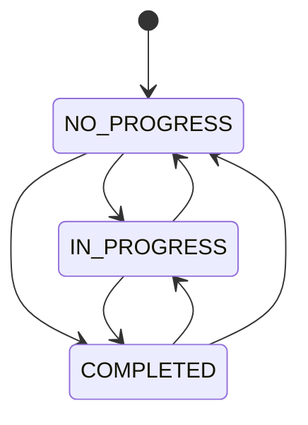

# Entity Lifecycles and Terminal Outcomes — Consologist TMS

Last checked: 2026-11-19. Derived from `prisma/schema.prisma`, `src/modules/**`, `src/lib/**`. No runtime execution.

## Entity Index

| Entity / stable ID | Exact status field(s) | Lifecycle owner | Pages | APIs/functions | Requirement / benefit |
|---|---|---|---|---|---|
| ENT-SESSION `Session` | expiry only (`expiresAt`) | auth-session | `/login`, `/logout` | `createSession`, `getSession`, `destroySession` | Revocable login |
| ENT-TOKEN `EmailToken` | `consumedAt`, `expiresAt` | auth-session | reset | `createEmailToken`, `consumeEmailToken` | One-time reset |
| ENT-INVITE `Invitation` | `accepted`, `expiresAt` | membership | users, accept | `gkInviteUser`, `acceptInviteAction` | Onboarding |
| ENT-ROLE `UserCompanyRole` | `Role` (READ_ONLY…SUPER_ADMIN) | auth-rbac | shell | `getUserRole` | Admin bypass/nav |
| ENT-RBAC template/override/assignment/audit | `AccessLevel`, `requiresApproval` | auth-rbac | permissions placeholder | `assignment-service` | Page authorization |
| ENT-TASK `Task` | `status`, `progress`, `completedAt` | task domain | tasks/detail | `gkCreateTask`, `gkUpdateTaskStatus` | Work item |
| ENT-ASSIGNEE `TaskAssignee` | row presence | task domain | tasks/detail | `gkCreateTask`, query include | Multiple owners + alert recipients |
| ENT-TAG `Tag` / `TaskTag` | row presence | task domain | tasks | `gkCreateTask` upsert | Custom tags |
| ENT-COMMENT `Comment` | row presence | task domain | task detail | `gkCreateComment` | Discussion + alerts |
| ENT-ALERT `EmailAlert` | row presence (`dedupeKey`) | alerts | none | `deliver` | One email per event |
| ENT-PREF `EmailAlertPreference` | 4 booleans | alerts | account | preferences service | Opt-out |
| ENT-BACKUP `Backup` | row + storage locations | backup | backups | backup service | Restore point |
| ENT-SCHED `BackupSchedule` | `isActive`, `nextRunAt` | backup | none | unused | Scheduled backups (unimplemented) |
| ENT-APPROVAL `PendingApproval` | `status` default `PENDING` | auth-rbac/app | none | `approvalRouter` | Maker-checker (no executor) |
| ENT-MCPKEY `McpApiKey` | `revokedAt`, `lastUsedAt` | MCP/auth | account | validator, account actions | Agent auth |
| ENT-DRIVE `CompanyGoogleDrive` | connection row + env | google-drive | none | `isConnected`, `saveConnection` | Drive storage |
| ENT-GROUP/PROJECT/APP | row presence / archived | workspace | placeholders | seed only | Project organization |
| ENT-SCHEMA-ONLY Discussion/FileFolder/FileRecord/TimeRecord/CalendarEvent/Milestone/Issue/SavedSearch/GroupMember/GroupApplication | row presence | none implemented | placeholders | none | Proposed clone scope |

## Domain: Authentication Session

### States

| Exact state | Meaning | Created by | User-visible | Terminal/intermediate | Allowed actions | Status |
|---|---|---|---|---|---|---|
| ACTIVE | DB row exists, JWT not expired | `createSession` | yes | intermediate | authenticated requests; logout | statically traced |
| EXPIRED | `expiresAt` passed or JWT expired | time | implicit | terminal | none; new login | statically traced |
| REVOKED | DB row deleted | `destroySession`, reset password | implicit | terminal | none | statically traced |

### Transitions

| From | To | Trigger / guard | Actor | Enforcing file | Validation | Side effect | GUI | Outcome |
|---|---|---|---|---|---|---|---|---|
| — | ACTIVE | valid credentials | visitor | `login/actions.ts` | bcrypt compare | Session row + cookie | login | signed in |
| ACTIVE | REVOKED | logout | member | `(dashboard)/actions.ts` | session token | row delete + cookie delete | header | signed out |
| ACTIVE | REVOKED | password reset | token holder | `reset-password/actions.ts` | consumed token | all user sessions deleted | reset | re-login required |
| — | ACTIVE | invite accepted | invitee | `accept-invite/actions.ts` | valid token/password | session + cookie | accept | signed in |

### Branches

| Branch | Guard | Timeout/retry | Compensation | Terminal | Owner/test |
|---|---|---|---|---|---|
| Invalid password | compare false | none | none | login error | unverified |
| Missing/invalid JWT in proxy | `jwtVerify` | none | cookie cleared | redirect login | unverified |
| No workspace | `getActiveCompany` | redirect | invite or create workspace | redirect | unverified |

### Invariants

| Invariant | Enforced by |
|---|---|
| Session cookie is httpOnly, sameSite=lax, secure in production | login/register/accept actions |
| A reset revokes all sessions for that user | reset action transaction |
| JWT check is stateless; DB revocation checked by `requireAuth` | `proxy.ts` + `get-session.ts` |

## Domain: Email Token (Password Reset)

| State | Meaning | Terminal | Transition trigger |
|---|---|---|---|
| ISSUED | row, unconsumed, unexpired | no | `createEmailToken` |
| CONSUMED | `consumedAt` set | yes | `consumeEmailToken` atomic `updateMany` |
| EXPIRED | `expiresAt <= now` | yes | time; consume throws |

Transitions: ISSUED → CONSUMED on valid reset; ISSUED → EXPIRED on time. No reuse. Invariant: single use under concurrency via conditional `updateMany` (count must be 1).

Branch table:

| Branch | Guard | Terminal |
|---|---|---|
| Unknown email on forgot | user null | generic sent page (no enumeration) |
| Email send failure | try/catch | token remains; generic page |
| Invalid/expired token | consume throws | reset error page |

## Domain: Invitation

### States

| State | Meaning | Terminal |
|---|---|---|
| PENDING | unaccepted, unexpired | no |
| ACCEPTED | `accepted=true` | yes |
| EXPIRED | time passes | yes |
| REVOKED | row deleted | yes |

### Transitions

| From | To | Trigger | Enforcing file | Side effect | GUI | Outcome |
|---|---|---|---|---|---|---|
| — | PENDING | invite user | `membership.gkInviteUser` | Invitation + optional User; email best-effort | users | invite sent |
| PENDING | ACCEPTED | accept with token | `accept-invite/actions.ts` | password set, role upsert, session | accept | member joined |
| PENDING | REVOKED | revoke | `revokeWorkspaceInvitation` | row delete | users | invite removed |
| PENDING | EXPIRED | 24h | time | none | accept | error |

Branches: duplicate active invite rejected; email failure does not roll back; existing user password is overwritten on accept (risk); existing member role is upserted/overwritten (risk). Invariant: email unique per active invitation (application check, not DB unique).

## Domain: Page Permission (RBAC)

Access levels: `NONE` → `READ_ONLY` → `READ_WRITE`. Effective permission = user override if present, else assigned template page, else default `NONE` (assignment service; statically traced). `SUPER_ADMIN` returns `READ_WRITE` without DB lookup.

| Transition | Guard | Enforcing | Effect |
|---|---|---|---|
| NONE → any | template/override update | `assignment-service` (no GUI) | page visibility/actions |
| READ_ONLY → READ_WRITE | template/override | same | write actions allowed |
| any → NONE | template/override | same | page redirect / Access Denied |
| approval required | `PermissionTemplatePage.requiresApproval` | `getPageApprovalRequired` | creates → PendingApproval; non-create writes denied |

Invariants: server check on full load (`layout.tsx` + `x-pathname`), client guard on soft nav (`PageAccessGuard`), nav filtering is UX only. No permission-assignment UI exists (GAP-09).

## Domain: Task

### States

| State | Meaning | Terminal | Allowed actions |
|---|---|---|---|
| `NO_PROGRESS` | created/default | no | edit, assign, comment, status change |
| `IN_PROGRESS` | active work | no | same |
| `COMPLETED` | done (`completedAt` set, progress 100) | yes (reopenable) | status change back |

### Transitions

| From | To | Trigger | Actor | Enforcing | Validation | Side effect | GUI | Status |
|---|---|---|---|---|---|---|---|---|
| — | NO_PROGRESS/IN_PROGRESS/COMPLETED | create | WRITE page | `gkCreateTask` | project/list/company, membership, dates, tags | task + assignees + tags | tasks form | statically traced |
| any | any | status update | WRITE page | `gkUpdateTaskStatus` | task in company; enum only | progress/completedAt | inline select | statically traced |
| — | PENDING approval | create when `needsApproval` | WRITE page | action branch | Zod | PendingApproval only | tasks form | statically traced; no approver |

No transition table guard beyond the enum; custom statuses and workflow rules are not implemented (GAP-02). Status transitions are not audited.

Invariants: task must belong to a project in the active company; list must belong to the project; assignees must be project members; start ≤ due; tag titles unique per company (`Tag @@unique([companyId,title])`); order = max+1000 per list.

## Domain: Task Assignee

| State | Meaning | Terminal | Transition |
|---|---|---|---|
| ASSIGNED | join row exists | yes (until removal) | create |
| REMOVED | row deleted | yes | **no implemented removal path** |

No update/remove UI or MCP tool. Multiple assignees are unique by `(taskId,userId)`. Recipients of due/comment/mention alerts.

## Domain: Tag / Task Tag

| State | Meaning | Transition |
|---|---|---|
| EXISTS | company-scoped `Tag` row | upsert at task create |
| ATTACHED | `TaskTag` row | create at task create |

No tag rename/delete/list UI or MCP tool; no detach. Tags are reusable across tasks by exact title (case-sensitive). Owner is the creating user; owner is not consumed elsewhere.

## Domain: Comment

| State | Meaning | Terminal |
|---|---|---|
| CREATED | row exists | yes (immutable in code) |

Transition: create only. No edit/delete. `itemType`/`itemId` are polymorphic; only `"task"` is used by comment alerts. Comment creation triggers assignee/mention alerts post-commit.

## Domain: Email Alert and Preference

| State | Meaning | Terminal |
|---|---|---|
| CLAIMED | `EmailAlert` row inserted before send | no (sentAt default now) |
| SENT | provider accepted | yes |
| FAILED | provider rejected; row remains, no retry | yes (silently) |

| Preference | Default | Consumer |
|---|---|---|
| dueSoon | true | `runDueAlerts` |
| overdue | true | `runDueAlerts` |
| comment | true | `notifyTaskComment` |
| mention | true | `notifyTaskComment` |

Invariants: only current assignees receive email; actor excluded; mention alert wins over comment alert for the same comment; dedupe key unique. **Claim-before-send and `take:500` are defects** (GAP-06).

## Domain: Backup and Restore

### States

| State | Meaning | Terminal |
|---|---|---|
| CREATED | encrypted file + `Backup` row | no |
| STORED | one or more destinations | no |
| DELETED | storage + row removed | yes |
| SAFETY | pre-restore backup | no |
| RESTORED | workspace data replaced | yes (per restore operation) |

### Transitions

| From | To | Trigger | Enforcing | Validation | Side effect | GUI | Status |
|---|---|---|---|---|---|---|---|
| — | CREATED/STORED | create backup | `createWorkspaceBackup` | password ≥8, source export | encrypted file(s) + row | backups | statically traced |
| STORED | DELETED | delete | `deleteWorkspaceBackup` | company scope | remove DB/filesystem/Drive object | backups | statically traced |
| STORED | SAFETY + RESTORED | restore | `executeWorkspaceRestore` | password, typed `RESTORE`, checksum | full clear+import in one transaction | backups, MCP | statically traced; **not rehearsed** |

Branches: wrong password/decrypt failure; checksum mismatch; missing/extra sources (preview); source import failure → transaction rollback; Drive unavailable; restore is full-only. Ongoing service: `BackupSchedule`/retention have no caller or UI (GAP-11).

## Domain: Pending Approval

| State | Meaning | Terminal |
|---|---|---|
| PENDING | row created for a write | **not reached** — no executor |

No APPROVED/REJECTED/CANCELLED transition is implemented. Payload is stored JSON; no reviewer UI or handler. Approval-required users cannot complete the write (GAP-05).

## Domain: MCP API Key

| State | Meaning | Terminal |
|---|---|---|
| ACTIVE | row, `revokedAt=null` | no |
| REVOKED | `revokedAt` set | yes |

Transitions: create (raw key shown once, bcrypt hash stored) → validate at boot (constant-time compare, updates `lastUsedAt`) → revoke. Multiple active keys per user allowed. Keys are company-scoped. Revocation affects next boot, not a running subprocess. No rotation UI beyond create/revoke.

## Domain: Google Drive Connection

| State | Meaning | Terminal |
|---|---|---|
| ABSENT | no `CompanyGoogleDrive` row or env missing | no |
| CONNECTED | encrypted refresh token + folder | no |
| DISCONNECTED | row deleted | yes |

Module exposes OAuth/exchange/upload/share functions; no connect/disconnect GUI or callback route (GAP-10). `isConnected` also requires `GOOGLE_DRIVE_CLIENT_ID/SECRET/ENCRYPTION_KEY` and not `preferLocalStorage` (field is not in the current schema; the module reads it defensively).

## Domain: Project Group / Project / Application

Created only by `seedStarterWorkspace` at registration/workspace creation. No create/edit/archive UI or MCP tools. `Application` catalog is global and seeded idempotently. Project apps installed: tasks, discussions, files, calendar. `fManaged`, `fPublic`, `color`, `description` are stored but not used by any rendered surface. Status: proposed scope.

## Domain: Schema-only Product Entities

`Discussion`, `FileFolder`, `FileRecord`, `TimeRecord`, `CalendarEvent`, `Milestone`, `Issue`, `SavedSearch`, `GroupMember`, `GroupApplication` have schema and (some) backup sources but no GUI, MCP, or gatekeeper. They are **proposed** clone scope, not implemented behavior. `FileRecord.driveFileId/webViewLink/downloadUrl` presume Drive uploads that do not exist yet.

## Utility and Reconciliation

Full inventory and evidence: `docs/domain/UTILITY_TRACEABILITY.md`. All lifecycle claims here are **statically traced**; none are **runtime verified**. Transitions absent from these tables are not permitted without updating the business decision, evidence, and table.

`review-required: entity lifecycles ready for reviewer acceptance; approval, backup, and MCP gaps block runtime acceptance.`
