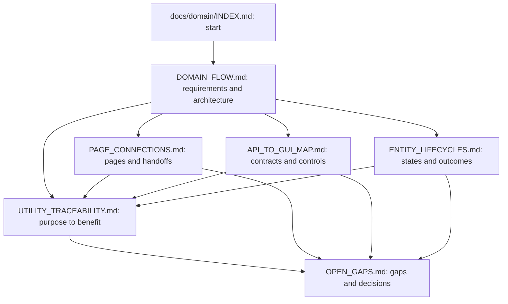

# Domain Architecture and Flow Master Index — Consologist TMS

Start here to find requirements, authoritative architecture, element uses, terminal outcomes, and evidence for Consologist TMS.

Last checked: 2026-11-19. Canonical lane for builders and reviewers: this file → `DOMAIN_FLOW.md` → the five detailed documents below → `OPEN_GAPS.md`.

## Reading Guide

| Need | Read first | Then read |
|---|---|---|
| Whole-system requirements-to-outcome architecture | `../../DOMAIN_FLOW.md` | Relevant detailed documents |
| Pages and routes | `PAGE_CONNECTIONS.md` | `API_TO_GUI_MAP.md` |
| API contracts and GUI controls | `API_TO_GUI_MAP.md` | `UTILITY_TRACEABILITY.md` |
| States, branches, terminal outcomes | `ENTITY_LIFECYCLES.md` | Actual code/contracts/tests |
| Every element's purpose and useful behavior | `UTILITY_TRACEABILITY.md` | Sources, real tests, and gaps |
| Unresolved risks | `OPEN_GAPS.md` | Linked evidence |
| Runtime proof | `RUNTIME_VERIFICATION.md` | Tests, scripts, and browser evidence |

## Navigation Hierarchy

| Level | Holds | Example in this doc set |
|---|---|---|
| L1 root index | Topic/keyword → file map | This `INDEX.md` |
| L2 section/file index | Component → exact location within a file | `ENTITY_LIFECYCLES.md` domain headings with States / Transitions / Invariants subsections |
| L3 referenceable entries | Individual rules, transitions, rows, traces | Stable IDs `REQ-*`, `PAGE-*`, `ACT-*`, `MCP-*`, `ENT-*`, `UT-*`, `GAP-*`, `BR-*`, `ORPH-*`, `EDGE-*` |

Rules: one heading level per tier; every L3 entry is reachable from its L2, every L2 from L1; cross-references use exact headings or stable IDs; add an entry and update its parent in the same change.

## File Ownership

| File | Responsibility | Owner/role | Update when |
|---|---|---|---|
| `DOMAIN_FLOW.md` | Requirements, boundaries, modules, pages, terminal outcomes | Architect/planner/reviewer | Requirement, boundary, relationship, or outcome changes |
| `docs/domain/INDEX.md` | File map and canonical reading lane | Reviewer/orchestrator | Document set, status, or ownership changes |
| `docs/domain/PAGE_CONNECTIONS.md` | Routes, navigation, pages, handoffs | Planner/reviewer | Page or user journey changes |
| `docs/domain/API_TO_GUI_MAP.md` | Inputs/outputs, controls, entities, benefits | Executor/reviewer | Contract, form, or rendered result changes |
| `docs/domain/ENTITY_LIFECYCLES.md` | States, transitions, invariants, branches, terminal outcomes | Architect/reviewer | Business rules or states change |
| `docs/domain/UTILITY_TRACEABILITY.md` | Full inventory, purposes, consumers, benefits, dispositions, bidirectional tracing, evidence | Architect/planner/reviewer/TesterQA | Any element, requirement, consumer, branch, or evidence changes |
| `docs/domain/RUNTIME_VERIFICATION.md` | Runtime evidence and defects fixed | Reviewer/QA | When a runtime test is added or a defect is fixed |
| `docs/domain/OPEN_GAPS.md` | Questions, risks, orphan candidates, owners, acceptance impact | Orchestrator/reviewer | Gap found, deferred, or resolved |

Architect is a responsibility, not a new profile. Planner preserves the accepted journey and full scope; executor implements wiring and updates docs; reviewer checks inventory and semantics; TesterQA proves behavior; orchestrator blocks high-stakes downstream work until accepted.

## Current Documentation Register

| File | Exists? | Last checked | Status, evidence, owner, limits |
|---|---|---|---|
| `../../DOMAIN_FLOW.md` | yes | 2026-11-20 | Design + implementation reconciled; runtime evidence in `RUNTIME_VERIFICATION.md` |
| `docs/domain/INDEX.md` | yes | 2026-11-19 | This file |
| `docs/domain/PAGE_CONNECTIONS.md` | yes | 2026-11-19 | Route inventory from `src/app/**/page.tsx` + `route.ts` (32 pages, 4 routes) |
| `docs/domain/API_TO_GUI_MAP.md` | yes | 2026-11-19 | 43 server actions, 37 MCP tools, 4 API routes |
| `docs/domain/ENTITY_LIFECYCLES.md` | yes | 2026-11-19 | Prisma schema + gateways inspected statically |
| `docs/domain/UTILITY_TRACEABILITY.md` | yes | 2026-11-20 | Structural pass; runtime unverified |
| `docs/domain/RUNTIME_VERIFICATION.md` | Runtime evidence and defects fixed | Reviewer/QA | When a runtime test is added or a defect is fixed |
| `docs/domain/RUNTIME_VERIFICATION.md` | yes | 2026-11-20 | Runtime DB, browser, MCP, cron and email evidence |
| `docs/domain/OPEN_GAPS.md` | yes | 2026-11-20 | Gaps with owners and acceptance impact |

Status vocabulary — keep distinct: **required**, **proposed**, **accepted design**, **statically traced**, **runtime verified**, **unresolved**. Accepted design is not implementation; static inspection is not runtime proof.

## Documentation Overview

## Canonical Reading Lane

1. `docs/domain/INDEX.md` (this file)
2. `DOMAIN_FLOW.md`
3. `docs/domain/API_TO_GUI_MAP.md`, `ENTITY_LIFECYCLES.md`, `PAGE_CONNECTIONS.md`
4. `docs/domain/UTILITY_TRACEABILITY.md`
5. `docs/domain/OPEN_GAPS.md`

Source precedence when documents conflict:

1. Explicit user instructions and preferences in the current project conversation.
2. `CLAUDE.md`, `AGENTS.md`, `RULES.md`, and `.claude/rules/*` (mandatory project rules).
3. Captured Freedcamp reference behavior (`/home/mahrukh/rea-analysis/freedcamp/FREEDCAMP-REVERSE-ENGINEERING.md`, `RECONSTRUCTION-SCOPE.md`).
4. Current code in `src/` and `prisma/schema.prisma` (implementation truth, not automatically the desired business rule).

Everything outside this lane is `reference-only` (captured Freedcamp evidence) or `raw evidence` (REA captures). No document in this lane replaces runtime testing.

## Coverage and Acceptance Checks

- Reconcile all declared UI inputs, API parameters, database tables, functions, pages, processes, jobs, events, and outputs with actual forms/contracts, schema, routes/callers, and outputs. Counts are in `UTILITY_TRACEABILITY.md`.
- Each element has purpose, producer, validation, storage/transience rationale, concrete consumer, benefit, terminal disposition, and evidence/status.
- Trace requirements to terminal outcomes and every implemented element back to purpose.
- Orphans are wired, safely removed after review, or deferred outside accepted scope.
- Real tests establish input-to-benefit effects, output provenance, and branch outcomes. **No runtime behavioral test has been run against a database**, so all runtime claims are unresolved.
- High-stakes documents remain `review-required:` until reviewer/orchestrator acceptance.

`review-required: domain flow, full inventory, and utility evidence ready for reviewer/orchestrator acceptance.`
