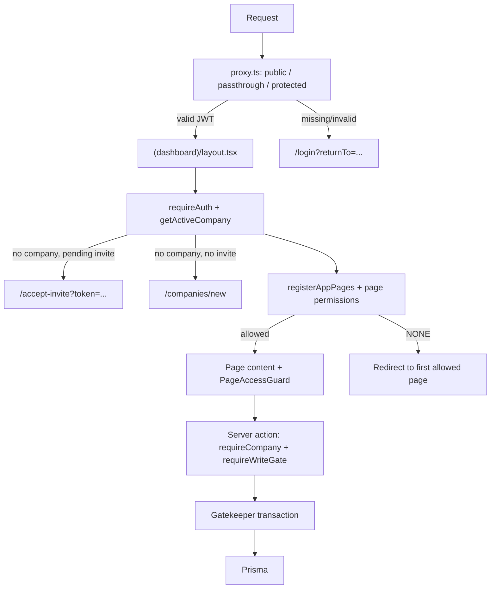

# Page Connections — Consologist TMS

Last checked: 2026-11-19. Sources: `src/app/**/page.tsx`, `src/app/**/route.ts`, `src/lib/nav/nav-sections.ts`, `src/proxy.ts`, `src/app/(dashboard)/layout.tsx`.

## Route Inventory (32 pages + 4 routes)

| ID | Route | File | Access | Status | Creates / reads / updates / hands off |
|---|---|---|---|---|---|
| PAGE-ROOT | `/` | `src/app/page.tsx` | public | implemented | Redirects to `/dashboard` |
| PAGE-LOGIN | `/login` | `src/app/(auth)/login/page.tsx` | public | implemented | Reads `User`; creates `Session`; hands to `returnTo` |
| PAGE-REGISTER | `/register` | `src/app/(auth)/register/page.tsx` | public | implemented | Creates `User`, `Company`, role, starter group/project/list/apps |
| PAGE-FORGOT | `/forgot-password` | `src/app/(auth)/forgot-password/page.tsx` | public | implemented | Creates `EmailToken`; sends reset email |
| PAGE-RESET | `/reset-password` | `src/app/(auth)/reset-password/page.tsx` | public + token | implemented | Consumes token; updates password; deletes sessions |
| PAGE-ACCEPT | `/accept-invite` | `src/app/accept-invite/page.tsx` | public + token | implemented | Updates user; upserts `UserCompanyRole`; marks invitation accepted; session |
| PAGE-NEW-WS | `/companies/new` | `src/app/companies/new/page.tsx` | authenticated, no workspace | implemented | Creates workspace + role + starter data |
| PAGE-HOME | `/dashboard` | `src/app/(dashboard)/dashboard/page.tsx` | pageKey `dashboard` | implemented | Reads project/task/in-progress counts |
| PAGE-TASKS | `/tasks` | `src/app/(dashboard)/tasks/page.tsx` | pageKey `tasks` | implemented | Lists tasks; create form; inline status update |
| PAGE-TASK-DETAIL | `/tasks/[id]` | `src/app/(dashboard)/tasks/[id]/page.tsx` | pageKey `tasks` (prefix match) | implemented | Reads task/comments; status update; add comment |
| PAGE-ACCOUNT | `/manage/account` | `src/app/(dashboard)/manage/account/page.tsx` | pageKey `manage-account`, always accessible | implemented | Profile; MCP keys/writes toggle; email alert prefs |
| PAGE-USERS | `/manage-system/users` | `src/app/(dashboard)/manage-system/users/page.tsx` | pageKey `manage-system-users` | implemented | Members/invitations; invite; revoke |
| PAGE-BACKUPS | `/manage-system/backups` | `src/app/(dashboard)/manage-system/backups/page.tsx` | pageKey `manage-system-backups` | implemented | Create/list/preview/restore/delete |
| PAGE-PROJECTS | `/projects` | placeholder | pageKey `projects` | placeholder | None |
| PAGE-DISCUSSIONS | `/discussions` | placeholder | pageKey `discussions` | placeholder | None |
| PAGE-FILES | `/files` | placeholder | pageKey `files` | placeholder | None |
| PAGE-CALENDAR | `/dashboard/calendar` | placeholder | pageKey `dashboard-calendar` | placeholder | None |
| PAGE-TIME | `/dashboard/time` | placeholder | pageKey `dashboard-time` | placeholder | None |
| PAGE-WIDGETS | `/dashboard/widgets` | placeholder | pageKey `dashboard-widgets`, always accessible | placeholder | None |
| PAGE-NOTIFICATIONS | `/notifications` | placeholder | pageKey `notifications` | placeholder | None |
| PAGE-CHAT | `/chat` | placeholder | pageKey `chat` | placeholder | None |
| PAGE-RECAP | `/daily-recap` | placeholder | pageKey `daily-recap` | placeholder | None |
| PAGE-ADMIN | `/manage-system` | placeholder | pageKey `manage-system` | placeholder | None |
| PAGE-PERMISSIONS | `/manage-system/permissions` | placeholder | pageKey `manage-system-permissions` | placeholder | None |
| PAGE-CRON | `/api/cron/due-alerts` | `src/app/api/cron/due-alerts/route.ts` | `CRON_SECRET` bearer / `x-cron-secret` | implemented | Runs `runDueAlerts`; returns `{dueSoon,overdue,scanned}` |

## Navigation Map (18 items, 17 unique pageKeys)

| Section | Label | Href | pageKey | Page exists? | Gating | Notes |
|---|---|---|---|---|---|---|
| Workspace | Home | `/dashboard` | `dashboard` | yes | page permission | — |
| Workspace | My Tasks | `/dashboard/tasks` | `dashboard-tasks` | **no** | page permission | Broken nav target (GAP-08) |
| Workspace | Calendar | `/dashboard/calendar` | `dashboard-calendar` | placeholder | page permission | — |
| Workspace | Time | `/dashboard/time` | `dashboard-time` | placeholder | page permission | — |
| Workspace | Widgets | `/dashboard/widgets` | `dashboard-widgets` | placeholder | always accessible | Duplicate pageKey with Preview |
| Projects | Projects | `/projects` | `projects` | placeholder | page permission | — |
| Projects | Task Board | `/tasks` | `tasks` | yes | page permission | Real work surface |
| Projects | Discussions | `/discussions` | `discussions` | placeholder | page permission | — |
| Projects | Files | `/files` | `files` | placeholder | page permission | — |
| Activity | Notifications | `/notifications` | `notifications` | placeholder | page permission | In-app Notification rows unread |
| Activity | Chat | `/chat` | `chat` | placeholder | page permission | — |
| Activity | Daily Recap | `/daily-recap` | `daily-recap` | placeholder | page permission | — |
| My Account | My Account | `/manage/account` | `manage-account` | yes | always accessible | — |
| My Account | Manage System | `/manage-system` | `manage-system` | placeholder | adminOnly nav + page permission | — |
| My Account | Users | `/manage-system/users` | `manage-system-users` | yes | adminOnly nav + page permission | — |
| My Account | Permissions | `/manage-system/permissions` | `manage-system-permissions` | placeholder | adminOnly nav + page permission | — |
| My Account | Backups | `/manage-system/backups` | `manage-system-backups` | yes | adminOnly nav + page permission | — |
| My Account | Preview | `/dashboard/widgets` | `dashboard-widgets` | placeholder | always accessible | Duplicate of Widgets |

Admin nav visibility: `Role.ADMIN` or `Role.SUPER_ADMIN` from `UserCompanyRole`. It is a UX filter; page checks remain authoritative.

## Access and Handoff Flow

## Page-Level 0 / 1 / N Handling

| Surface | 0 case | 1 case | N case | Evidence |
|---|---|---|---|---|
| Projects on `/tasks` form | Message "Create a project with a task list first"; no submit | One project/list preselected | Full selectors | `task-form.tsx`; static |
| Assignees on task form | Empty multi-select; task unassigned | One member selectable | Multiple selectable (`multiple`) | `task-form.tsx`; static |
| Tags on task form | Empty input accepted | Single tag | Comma-separated list up to 20 | `schema.ts`; static |
| Tasks list | "No tasks yet." | One row | Table, max 50 per page | `tasks/page.tsx`; static |
| Comments on task detail | "No comments yet." | One comment card | Comment list | `tasks/[id]/page.tsx`; static |
| Backups list | "No backups yet." | One row + restore `
` | Table + restore details per row | `backups/page.tsx`; static |
| Members/invitations | Empty message/zero count | One row | Lists | `users/page.tsx`; static |
| Nav sections | Section hidden when no items after filtering | One item | Full list | `layout.tsx`; static |

## Cross-Page Handoffs

| From | To | Trigger | Payload | Failure / recovery | Benefit |
|---|---|---|---|---|---|
| `/login` | `returnTo` or `/dashboard` | valid credentials | session cookie | invalid → login error | Session |
| `/register` | `/dashboard` | account + workspace created | session cookie | invalid/existing → register error | First workspace |
| `/companies/new` | `/dashboard` | workspace created | session cookie | action throws on DB error | Workspace |
| `/forgot-password` | `/reset-password?token=` | email exists | one-time token | email failure logged, generic response | Reset |
| `/reset-password` | `/login` | token consumed | password updated | invalid/expired → reset error | Recovery |
| `/manage-system/users` | `/accept-invite?token=` | invite created | invitation email | email failure leaves invitation; admin can resend only by re-invite (blocked if active) | Membership |
| `/tasks` | `/tasks/[id]` | row title / new-tab icon | task id | missing task → `notFound()` | Detail + comments |
| `/manage-system/backups` | same page | preview/restore/delete | backup id, password | errors returned via `notify` | Data protection |
| `/manage/account` | MCP subprocess | key created | raw key shown once | key not retrievable later | MCP auth |
| Cron | email recipients | schedule | due tasks | no retry after failure | Alerts |

## Known Navigation Defects

| Defect | Evidence | Impact | Decision |
|---|---|---|---|
| `/dashboard/tasks` nav item has no page | `nav-sections.ts` vs route inventory | 404 from primary nav | Fix route or remove nav item (GAP-08) |
| `/dashboard/widgets` listed twice (`Widgets`, `Preview`) | `nav-sections.ts` | Duplicate nav entry with same pageKey | Consolidate (open gap) |
| Admin/permissions pages are placeholders | route files | Admin cannot manage RBAC/templates | Implement or hide (GAP-09) |
| In-app notifications have no reader | `Notification` model/service; `/notifications` placeholder | Created rows are unconsumed | Wire or remove (ORPH-04) |

## Verification

- Route inventory generated by `find src/app -name page.tsx -o -name route.ts` (24 + 1).
- Nav inventory generated from `nav-sections.ts` (18 items).
- Cross-check performed by comparing nav hrefs to route filenames; one missing route, one duplicate pageKey.
- No browser runtime test was run.
